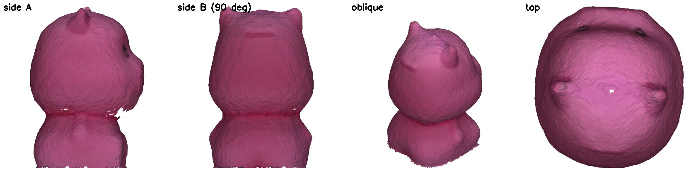

# Pinky Pro 3D Scan Bot

Pinky Pro 2대에 RealSense D455를 서로 다른 높이로 달고, 두 대가 물체 둘레를 함께 돌며 찍은 스냅샷으로 물체의 3D 메시를 만든다. 스캔 PC에서 명령 하나를 실행하면 두 로봇이 판 반대편에서 출발해 각자 24시점을 찍고, 스캔 PC가 두 높이의 사진을 하나의 메시로 합친다.



- 첫 두 대 스캔(2026-11-23): 한 바퀴 241 s, 두 로봇 모두 24시점 융합, 건너뛴 시점 0(`out/scan_20261123-211555/`)
- 개발 과정과 결과: [개발 보고서](docs/report/DEV-REPORT.md)

## 동작 방식

| 구성 | 하는 일 |
|---|---|
| 로봇 L(`pinky2`) | 카메라 바닥 위 0.15 m, 15° 아래. 물체 아래쪽 옆면을 찍는다. |
| 로봇 H(`pinky1`) | 카메라 바닥 위 0.45 m, 37° 아래. 위쪽 옆면과 윗면을 찍는다. |
| 표식 판 | A1 출력(594 × 594 mm), AprilTag 85 mm × 16장. 사진마다 카메라 위치와 방향을 구한다. |
| 로봇 쪽(`ros/scan3d_robot`) | 요청이 올 때만 카메라를 켜 원자료(컬러 1장, 깊이 여러 장)를 보내고, 이동 명령을 실행한다. odom과 LiDAR를 계속 보낸다. |
| 스캔 PC(`scan3d/`) | 표식 자세, 거리 유지와 장애물 판단, 두 대 엇갈림 진행, 깊이 정렬, TSDF 융합을 모두 맡는다. |

```text
로봇 L ─┐  TCP 7010 제어(hello, move, snapshot)
        ├──────────────────────────────────────▶ 스캔 PC: 표식 자세 → 주행 판단 → 정렬 → TSDF 융합 → mesh.ply
로봇 H ─┘  TCP 7011 스트림(odom, LiDAR, 상태)
```

두 로봇은 판을 사이에 두고 반시계로 돈다. 한 로봇이 찍는 동안 다른 로봇은 다음 시점으로 움직인다(엇갈림 촬영). 카메라는 물체에서 0.40 ~ 0.55 m(목표 0.45 m)를 유지하고, 원 경로에 장애물이 있으면 멈췄다가 바깥 차선으로 비켜 간다.

## 저장소 구조

```text
config/        현장 설정(scan.yaml), 시뮬레이션 설정, 표식 배치
docker/        스캔 PC 컨테이너
docs/          계획(plan/), 모듈 명세(specs/), 개발 보고서(report/), 이전 과제(archive/), 참고 예제(reference/)
out/           표식 판·각도기 PDF, 스캔 결과 사본
ros/           로봇 쪽 ROS 2 패키지: 구동(pinky_auto), 에이전트(scan3d_robot), Gazebo 시험(scan3d_sim). ros/README.md
scan3d/        스캔 PC 코드: 한 로봇(robot/), 두 대 합침(pair/), 가짜 로봇·합성(sim/)
scripts/       설치, 배포, 로봇 기동, 시뮬레이션 실행
tests/         스캔 PC 테스트와 재생 테스트
tools/         인쇄물 생성, 현장 점검, 스캔 실행
```

## 준비물

| 항목 | 내용 |
|---|---|
| 로봇 | Pinky Pro 2대(Raspberry Pi 5, Ubuntu 24.04, ROS 2 Jazzy) |
| 카메라 | RealSense D455 2대. 로봇의 파란 USB 3 포트에 꽂는다. |
| 카메라 기둥 | 차체 뒤쪽에 하나씩. 카메라는 가로로, 진행 방향 왼쪽을 보게 단다. 피치는 `out/angle_gauge_A4.pdf` 각도기로 맞춘다. |
| 표식 판 | `out/board_A1.pdf`를 A1, 실제 크기 100 %로 출력하고 점선 아래 594 × 594 mm를 잘라 평평한 바닥에 펴 놓는다. |
| 물체 | 바닥 윤곽이 지름 0.28 m 원 안, 높이 0.20 m 이하, 무광 |
| 스캔 PC | Python 3.12(Linux) 또는 Docker(amd64·arm64). 두 로봇과 같은 Wi-Fi |
| 바닥 | 빈 곳 약 2.2 × 2.2 m |

## 시작하기

모든 명령은 스캔 PC의 저장소 폴더에서 실행한다.

### 1. 스캔 PC 설치

```bash
git clone https://github.com/konor123/pinky-pro-scan-bot.git
cd pinky-pro-scan-bot
scripts/setup_station.sh            # 성공: station ok
```

Docker로 할 때는 [docker/README.md](docker/README.md)를 따른다.

### 2. 로봇 없이 돌려 보기

```bash
tools/scan.sh --fake --no-window    # 가짜 로봇 2대와 합성 영상으로 한 바퀴
```

`scans/<실행 ID>/out/`에 `mesh.ply`, `cloud.ply`, `report.txt`가 생긴다. `--obstacle 2`를 더하면 원 경로에 상자를 두고 우회까지 해 본다.

### 3. 로봇 연결

```bash
cp .env.example .env                # 로봇 SSID(로봇 LCD에 나옴)를 적는다
scripts/ssh_aliases.sh              # 같은 Wi-Fi에서 SSID로 주소를 찾아 pinky1·pinky2 별칭을 만든다
ssh-copy-id pinky1                  # 로봇 비밀번호는 제조사 위키 "초기설정"
ssh-copy-id pinky2
scripts/ssh_aliases.sh              # 성공: pinky1: pinky_d52c 확인, pinky2: pinky_6437 확인
```

로봇 주소가 바뀌면 `scripts/ssh_aliases.sh`를 다시 실행한다.

### 4. 로봇 설치(처음 한 번)

```bash
scripts/setup_robot.sh pinky1       # sudo 필요. 처음에는 재부팅 안내 → ssh -t pinky1 sudo reboot → 다시 실행
scripts/setup_robot.sh pinky2       # 성공: setup ok, 카메라 일련번호, USB 3 연결
scripts/deploy.sh pinky1            # 성공: build ok
scripts/deploy.sh pinky2
```

### 5. 스캔

1. 표식 용지를 평평한 바닥에 펴 놓고 가장자리만 테이프로 고정한다(표식과 그 둘레 흰 부분에는 붙이지 않는다). 물체를 판 가운데에 놓는다.
2. 두 로봇을 판을 사이에 두고 대략 반대편에 놓는다. 카메라에서 판 가운데까지 약 0.6 m, 카메라 쪽(로봇 왼쪽)이 판을 보게 한다. 로봇 앞·옆 30 cm 안과 원 경로 주변 바닥에는 배터리·케이블을 두지 않는다.
3. 실행한다.

```bash
scripts/robot.sh -H pinky1 start robot_scan
scripts/robot.sh -H pinky2 start robot_scan
tools/scan.sh --hello               # 성공: L: role L, H: role H, 두 일련번호가 다름
tools/scan.sh                       # 두 대 한 바퀴 → 메시 창
```

- 결과: `scans/<실행 ID>/`(원자료 `L/raw/`·`H/raw/`, 데이터셋, `out/mesh.ply`, `out/report.txt`)
- 한 대만: `tools/scan.sh --only L`(또는 `H`)
- 끝나면: `scripts/robot.sh -H pinky1 stop robot_scan`(pinky2도). 상태는 `scripts/robot.sh -H pinky1 status`

한 로봇은 한 번에 한 곳에서만 구동한다. 다른 사람이 구동 스택을 띄워 두었으면 `robot.sh start`가 시작하지 않고 그 프로세스를 보여 준다.

### 6. 다시 합치기

저장한 L·H 데이터를 지금 설정으로 다시 융합한다. 원래 폴더는 바꾸지 않는다.

```bash
.venv/bin/python -m scan3d.pair.recon scans/<id>/L scans/<id>/H                  # → scans/<id>/out_recon/
.venv/bin/python -m scan3d.pair.recon scans/<id>/L scans/<id>/H --color-opt 100 --out scans/<id>/out_color
```

## 현장 점검 도구

| 명령 | 확인하는 것 |
|---|---|
| `tools/led_check.py` | 두 로봇에 동시에 명령이 닿는지(뒤 LED, 주행 없음) |
| `tools/snapshot_test.py --robot L --count 5` | 스냅샷 반복 성공과 1회 시간 |
| `tools/lidar_view.py --robot L [--mask]` | odom·LiDAR 수신, 카메라 기둥에 가린 각도 |
| `tools/show_pose.py --robot L` | 표식으로 구한 카메라·로봇 위치 |
| `tools/drive_check.py --robot L` | `forward`·`turn` 이동이 표식으로 잰 값과 맞는지 |
| `tools/find_robots.py` | SSID로 로봇 주소 찾기 |
| `tools/upload.sh` | 스캔 PC의 `scans/`를 개발 PC로 보내기 |

막히는 경우와 대처는 [TODOs 8장](docs/plan/TODOs.md#8-막히면)에 있다.

## 설정

현장에서 바꾸는 값은 모두 `config/scan.yaml` 하나에 있다.

| 묶음 | 주요 값 |
|---|---|
| `board` | 인쇄한 표식 한 변 `tag_mm`(판을 재서 고친다) |
| `scene` | 물체 반지름 `r_obj`, 원 반지름 `R` 0.62 m, 시점 수 24, 바닥 자르기 `floor_cut` |
| `capture` | 해상도, 깊이 장수 `n_depth`, 버림 프레임 `n_skip`, 멈춘 뒤 대기 `settle_s`, 압축 `compress` |
| `drive` | 직진 속도, 거리 목표·범위, 장애물 부채꼴·거리, 우회 차선 |
| `lidar` | 장착 방향, 가린 각도 `mask` |
| `robots` | 역할별 SSH 별칭, 포트, 카메라 장착 위치·높이·피치 |
| `recon` | 복셀 크기, 가장자리 깊이 지우기 `edge_mm`, 색 다시 입히기 `color_opt_iter` |

## 시뮬레이션

Gazebo(시뮬레이션 PC: Ubuntu 24.04, ROS 2 Jazzy, `~/pinky_pro` 워크스페이스)에서 표식 판을 깐 방과 D455를 옆으로 단 로봇으로 한 바퀴를 돈다.

```bash
scripts/sim_scan.sh L               # 또는 H
scripts/sim_scan.sh L --obstacle    # 도는 도중 원 경로에 상자를 놓는다
```

## 테스트

```bash
.venv/bin/python -m pytest -q -m "not slow"    # 빠른 테스트
.venv/bin/python -m pytest -q                  # 전체(합성 재구성·통합 포함, 약 18분)
```

로봇 대신 가짜 에이전트, 카메라 대신 합성 영상, 주행 대신 2D 시뮬레이터로 전체 흐름을 검사한다. 개발 PC의 `scans/`에 실행 기록이 있으면 재생 테스트(`tests/replay`)가 그 원자료로 돈다.

## 문서

| 문서 | 내용 |
|---|---|
| [docs/plan/PLAN.md](docs/plan/PLAN.md) | 개발 계획: 목표, 배치와 그 근거, 접점(좌표, 메시지, 데이터셋, 설정) |
| [docs/plan/TODOs.md](docs/plan/TODOs.md) | 온라인·현장 할 일 목록. 현장 항목마다 명령, 성공 출력, 실패 때 할 일 |
| [docs/specs/](docs/specs/README.md) | 모듈별 1쪽 명세와 완료 테스트 |
| [docs/report/DEV-REPORT.md](docs/report/DEV-REPORT.md) | 개발 과정, 시험 결과, 문제와 해결, 남은 일 |

## 출발점으로 쓴 공개 예제

- [pinklab-art/pinky_pro](https://github.com/pinklab-art/pinky_pro): 로봇 구동
- [fhekwn549/pinky_sim_examples](https://github.com/fhekwn549/pinky_sim_examples): `command_driver`(문장 명령 주행), Gazebo D455 로봇과 방 만들기
- [realsenseai/librealsense](https://github.com/realsenseai/librealsense): Python 스냅샷과 소프트웨어 장치 정렬 예제
- [isl-org/Open3D](https://github.com/isl-org/Open3D) v0.20.0: TSDF 융합 예제(사본 `docs/reference/open3d-v0.20.0/`)
- OpenCV `aruco`: 표식 판 생성·검출
