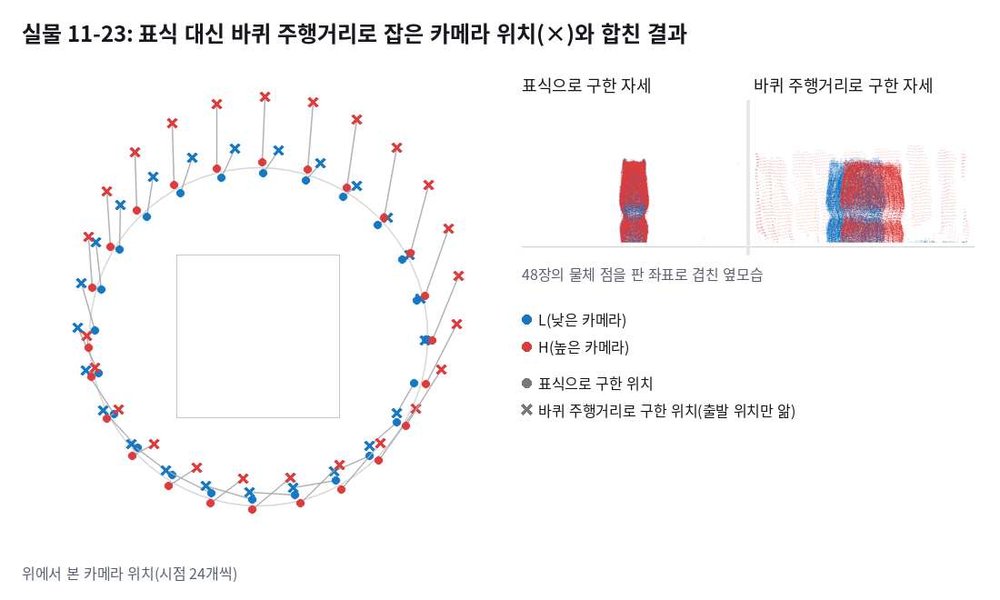

# 3D Scan Bot 발표 대본

- 발표 시간: 약 10분(17장)
- 발표자료: `docs/presentation/index.html`

---

### 1장 · 표지
시간: 약 20초

[화면] 아래 메시 그림 네 개를 가리킵니다.

안녕하세요, 3D Scan Bot 발표를 시작하겠습니다. Pinky Pro 두 대에 RealSense 카메라를 서로 다른 높이로 달아 물체 둘레를 찍고, 스캔 PC가 하나의 3D 메시로 합칩니다. 아래 그림이 실제로 만든 결과입니다.

넘김: 먼저 주제를 고른 과정부터 말씀드리겠습니다.

### 2장 · 주제 선정
시간: 약 35초

[화면] 표의 마지막 행과 아래 '고른 기준'을 가리킵니다.

11월 16일부터 태양광 패널 청소 로봇, 로봇 두 대 게임, 손 제스처 동기 동작을 차례로 검토했고, 네 번째로 3D 스캔 봇을 골랐습니다. 로봇에 카메라 기둥을 달고 출력한 표식 판을 바닥에 펴면 준비가 끝나, 현장에서 공작할 것이 없습니다. 그만큼 개발에 온전히 집중할 수 있다고 봤습니다.

넘김: 목표와 배치를 보겠습니다.

### 3장 · 목표
시간: 약 35초

[화면] 왼쪽 촬영 원 그림을 짚은 뒤, 오른쪽 옆모습 그림의 왼쪽 H와 오른쪽 L을 차례로 가리킵니다.

목표는 판 가운데에 물체를 두고 명령 하나로 두 로봇이 한 바퀴를 돌아, 화면에 3D 메시를 조립하는 것입니다. 로봇은 카메라 높이와 각도를 바꿀 수 없어서, 45 cm 높이의 H가 위쪽 옆면과 윗면을, 15 cm 높이의 L이 아래쪽 옆면을 맡습니다. 두 로봇이 판 반대편에서 출발해 15도 간격으로 24시점씩, 모두 48시점을 찍습니다.

넘김: 구현 전에 계획서에서 먼저 정한 것을 보겠습니다.

### 4장 · 계획서에서 먼저 정한 것
시간: 약 40초

[화면] 왼쪽 구성도를 짚은 뒤, 오른쪽 항목을 위에서부터 가리킵니다.

로봇은 센서 원자료를 보내고 주행 명령만 실행합니다. 영상 처리와 자세 계산, 주행 판단, 3D 융합은 모두 스캔 PC가 합니다. 영상을 계속 보내면 로봇 한 대에 초당 약 40 MB라서, 시점마다 한 번만 찍는 스냅샷으로 바꿨습니다. 카메라 자세는 사진마다 바닥 표식으로 구하고, 주행은 표식을 기준으로 바퀴의 이동·회전량을 더합니다. 모듈 사이 약속과 설정 파일도 이때 먼저 정했습니다.

넘김: 이렇게 모은 사진이 어떻게 3D 메시가 되는지 보겠습니다.

### 5장 · 3D 메시 만들기
시간: 약 40초

[화면] 위 그림 네 개를 왼쪽부터 차례로 가리킵니다.

11월 23일 스캔의 한 시점으로 최종 처리 과정을 보겠습니다. 로봇이 컬러 한 장과 깊이 여러 장을 보내면, 스캔 PC가 깊이 중앙값을 구해 컬러 시점에 맞추고 렌즈 왜곡을 폅니다. 그 컬러 사진에서 바닥 표식을 찾아 카메라 위치와 방향을 구합니다. 가장자리와 판 바닥을 지워 물체만 남긴 뒤, 48장을 2 mm 격자에 쌓아 표면까지 거리가 0인 곳을 이어 메시를 만듭니다.

넘김: 이 구성을 구현할 때 가장 큰 제약이 있었습니다.

### 6장 · 제약
시간: 약 20초

가장 큰 제약은 로봇 옆에서 실습할 시간이 짧다는 점이었습니다. 현장에서 일단 해 보고, 실패하면 고칠 시간이 없었습니다. 그래서 현장에 가기 전에 모든 준비를 끝내고, 현장에서는 장착과 확인, 촬영만 하기로 했습니다.

넘김: 이를 가능케 한 개발 절차입니다.

### 7장 · 개발 절차
시간: 약 35초

[화면] 위 흐름을 짚은 뒤, 아래 표와 오른쪽 합성 영상, '263개'를 차례로 가리킵니다.

실물은 마지막으로 미뤘습니다. 모듈 12개의 명세를 먼저 쓰고, 테스트를 만든 뒤 구현했습니다. 개발 PC에서는 가짜 로봇과 합성 영상, 2D 시뮬레이터로 실물을 대신했고, 가짜 로봇 두 대 시험과 Gazebo 시험을 거쳐 로봇에 설치했습니다. 지금 자동 테스트 263개가 모두 통과합니다.

넘김: 바탕이 된 SDD와 TDD를 간단히 짚겠습니다.

### 8장 · SDD · TDD란
시간: 약 30초

SDD는 코드보다 명세를 먼저 써서, 모듈마다 하는 일과 입력·출력, 완료 조건을 정하는 방식입니다. 모듈 사이 약속이 먼저 정해져 나눠 만들어도 맞추기 쉽습니다. TDD는 실패하는 테스트를 먼저 쓰고, 통과할 만큼 구현한 뒤 정리하는 주기입니다. 저희는 명세의 완료 조건을 그대로 첫 테스트로 썼습니다.

넘김: 실제 예를 보겠습니다.

### 9장 · 명세와 테스트
시간: 약 35초

명세 마지막의 '완료 테스트' 표를 그대로 자동 테스트 코드로 옮겼습니다. 표식 자세는 정답을 아는 합성 영상에서 위치 3 mm, 각도 1도 미만인지 봅니다. 주행은 시뮬레이터에 상자를 놓고, 기다렸다 비켜 가서 원으로 돌아오는지 봅니다. 바닥 높이 가정을 바꿀 때도 테스트 기대값부터 바꿔 실패를 확인한 뒤 코드를 고쳤습니다.

넘김: 이렇게 현장 전 준비를 마쳤습니다.

### 10장 · 현장 실습 전
시간: 약 35초

[화면] 오른쪽 Gazebo 그림의 위 L, 아래 H를 가리킵니다.

현장에서 실습하기 전날, 가짜 로봇 두 대 시험과 Gazebo 시험을 모두 통과했습니다. 두 시험 모두 기준 상자를 1 cm 오차 안으로 재구성했고, Gazebo에서는 장애물 앞에서 멈췄다 비켜 가는 것도 확인했습니다. 현장 할 일은 단계마다 명령 하나, 성공 출력, 실패 때 할 일로 정리했고, 현장에서 바꿀 값은 설정 파일 하나에 모았습니다.

넘김: 11월 21일 현장 시운전입니다.

### 11장 · 11-21 시운전
시간: 약 40초

[화면] 오른쪽 영상에서 인형 둘레를 도는 두 로봇을 가리킵니다.

11월 21일, 오락실에서 뽑은 인형으로 시운전했습니다. USB 전류를 설정한 뒤 카메라 영상이 정상으로 들어오는 것을 확인하고, 각도기로 카메라 기울기를 맞췄습니다. 스냅샷 전송이 끊기는 문제가 있었지만 그날 고쳐 세 번 모두 성공했습니다. 두 로봇 동시 제어도 확인했고, L 한 대는 274초, 두 대는 358초에 한 바퀴를 돌아 둘 다 메시를 만들었습니다.

넘김: 두 대 스캔 결과를 보겠습니다.

### 12장 · 2대 동시 스캔 성공
시간: 약 35초

[화면] 위 결과 그림과 아래 L·H 첫 사진을 가리킵니다.

명령 하나로 두 로봇이 판 반대편에서 함께 한 바퀴를 돌았습니다. 아래 사진처럼 L은 아래 옆면을, H는 위 옆면과 윗면을 찍어 하나로 합쳤습니다. 다만 시점마다 두 로봇이 차례로 찍는 방식이라, 한 대보다 느린 358초가 걸렸습니다. 이것이 다음 과제였습니다.

넘김: 11월 23일부터는 품질과 속도를 개선했습니다.

### 13장 · 품질 개선
시간: 약 40초

[화면] 왼쪽 표, 오른쪽 위 합성 상자 수치, 아래 메시를 차례로 가리킵니다.

품질은 네 가지를 바꿨습니다. 3 mm였던 TSDF 칸을 2 mm로 줄이고, 깊이가 급하게 바뀌는 가장자리를 지우고, 바닥 자르기 높이를 3 mm에서 5 mm로 올렸습니다. 저장한 데이터를 새 설정으로 다시 합치는 명령도 만들어, 다시 찍지 않고 비교할 수 있게 했습니다. 같은 합성 상자에서 꼭짓점이 약 2.5배로 늘었고, 아래는 23일에 다른 피규어로 만든 메시입니다.

넘김: 다음은 속도입니다.

### 14장 · 속도 개선
시간: 약 45초

[화면] 왼쪽 '이전'과 '엇갈림' 막대를 비교한 뒤, 오른쪽 막대 세 개를 가리킵니다.

두 대가 느렸던 이유는 한 로봇이 찍는 동안 다른 로봇이 서서 기다렸기 때문입니다. 그래서 한 대가 찍을 때 다른 한 대는 다음 자리로 움직이는 엇갈림 촬영으로 바꾸고, 멈춘 뒤 기다리는 시간도 줄였습니다. 11월 23일 스캔은 241초로, 21일보다 약 3분의 1 짧았습니다. 물체가 달라 같은 조건의 비교는 아닙니다. 그날 직진 속도를 올리고 전송량을 줄여, 한 바퀴 약 185초를 예상합니다.

넘김: 241초를 기록한 11월 23일 결과입니다.

### 15장 · 11-23 결과
시간: 약 50초

[화면] 왼쪽 영상과 아래 숫자 네 개를 짚은 뒤, 오른쪽 '완성 메시 둘러보기'를 눌러 메시를 돌려 보입니다.

두 로봇이 엇갈려 움직이며 찍어, 명령부터 메시 파일까지 241초가 걸렸습니다. L과 H 각각 24시점, 모두 48시점이 합쳐졌고, 건너뛴 시점이나 멈춤은 없었습니다. 표식 재투영 오차는 최대 1.76픽셀이었습니다. 완성 메시를 돌려 보면, 아래와 위에서 찍은 면이 한 겹으로 이어진 것을 볼 수 있습니다.

넘김: 이어서 11월 25일 촬영입니다.

### 16장 · 11-25 결과
시간: 약 35초

[화면] 오른쪽 변경 세 가지와 오른쪽 아래 시간을 짚은 뒤, 왼쪽 영상을 가리킵니다.

23일 촬영 뒤 직진 속도를 초속 0.10 m로 올리고, 시점마다 하던 마지막 회전을 없애고, 깊이 장수를 줄여 압축했습니다. 높은 카메라 기준 스냅샷은 3.4초에서 2.5초로 줄었습니다. 이를 모두 적용해 11월 25일 다시 찍은 영상입니다. 한 바퀴는 약 185초로 예상했습니다.

넘김: 마지막으로 돌아보겠습니다.

### 17장 · 돌아보며
시간: 약 30초

현장에서 공작이 필요 없는 주제를 고른 덕분에 개발에 온전히 집중할 수 있었습니다. 짧은 현장 시간은 명세와 테스트, 시뮬레이션으로 미리 준비해 메웠고, 현장에서 생긴 문제는 그날 고쳤습니다. 남은 현장 시간은 품질과 속도 개선에 썼습니다. 감사합니다.

---

## 예상 질문과 답

### Q1. 왜 바닥에 표식(마커)을 깔았나요? 표식 없이도 할 수 있지 않나요?

답: 사진 48장을 합치려면 사진마다 카메라 위치와 방향이 정확해야 합니다. 바닥 표식을 쓰면 사진 한 장만으로 판 기준 자세가 나와, 앞 시점의 바퀴 오차가 다음 사진에 쌓이지 않습니다. 표식 대신 바퀴 주행거리로 다시 합쳐 보니, 장착값을 맞춰 줘도 방향이 3 ~ 4도 어긋나 메시가 무너졌습니다.

보탤 말: 시뮬레이션에서는 위치 어긋남이 2 ~ 3 cm로 작아 상자 모양이 나왔습니다. 시뮬레이션만 봤다면 표식 없이도 된다고 판단할 뻔했습니다.

실험(11-25, 표식 없이 다시 합치기): 저장한 스캔에서 카메라 자세를 표식 대신 바퀴 주행거리(odom)로 잡아 다시 합쳤습니다. 출발 위치와 카메라 높이·기울기는 출발 사진 한 장의 표식으로 맞춰 주어, 표식 없는 쪽에 유리한 조건입니다.

| | 실물 11-23(분홍 피규어) | Gazebo 11-20(상자 180 × 140 × 160 mm) |
|---|---|---|
| 장착값 그대로 · 위치 어긋남(중앙값 · 최대) | L 148 · 190 mm, H 224 · 261 mm | L 33 · 132 mm, H 19 · 34 mm |
| 장착값 그대로 · 방향 어긋남(중앙값 · 최대) | L 3.7 · 10.1°, H 2.7 · 5.2° | L 4.1 · 8.5°, H 1.3 · 2.9° |
| 장착·바퀴 배율을 맞춘 뒤(±5 cm · ±5° · ±5 % 안) · 위치 | L 29 · 98 mm, H 50 · 138 mm | — |
| 같은 조건 · 방향 | L 3.9 · 9.9°, H 3.0 · 5.3° | — |
| 합친 결과의 가장 큰 덩어리 | 표식 99.9 % · 바퀴 그대로 11.6 % · 맞춘 뒤 18.2 % | 표식 100 % · 바퀴 96 % |
| 치수 | 표식 138 × 128 × 203 mm, 바퀴는 물체 모양이 안 나옴 | 표식 186.1 × 144.2 × 160.3 mm, 바퀴 181.6 × 143.8 × 160.4 mm |

- 바퀴 주행거리 자세(장착값 그대로)에서는 반지름 0.20 m 자르기 원기둥이 물체를 빗나가, H 24장 중 16장만 융합에 쓰였습니다.
- 장착값과 배율을 범위 제한 없이 맞추면 위치 어긋남이 중앙값 14 ~ 19 mm까지 줄지만, 카메라가 차체에서 30 cm 넘게 떨어져 있다는 실제와 맞지 않는 값이 나옵니다. 방향 어긋남(2 ~ 4°)은 그대로라 합친 결과도 무너졌습니다(가장 큰 덩어리 30 %).
- Gazebo는 L·H가 따로 돈 한 바퀴씩이고, L 카메라는 당시 장착(0.20 m · 10°)입니다. 장착값이 설계와 같아 어긋남이 작았고, 치수는 표식 쪽과 비슷했습니다.

### Q2. 두 대가 함께 찍으면 적외선 무늬가 서로 간섭하지 않나요?

답: 스캔 PC는 한 번에 한 대에만 촬영을 요청하고, 로봇은 다 찍으면 카메라를 끕니다. 

### Q3. 재투영 오차가 최대 1.76픽셀이면 실물 치수도 ±1 cm 안에 들어오나요?

답: 1.76픽셀은 구한 카메라 자세로 표식을 다시 그렸을 때 사진 속 표식과 어긋난 정도입니다. 치수에는 깊이 센서 오차도 더해집니다. Gazebo 기준 상자는 축마다 6 mm 안이었지만, 실물 ±1 cm는 기준 상자를 스캔해 확인할 차례입니다.

### Q4. 촬영 거리는 어떻게 유지하고, 길에 장애물이 있으면 어떻게 하나요?

답: 바닥 표식으로 물체 경계까지의 거리를 매번 계산해 목표 45 cm, 허용 40 ~ 55 cm를 지킵니다. 벗어나면 같은 각도에서 거리를 맞춰 다시 찍습니다. 다음 자리로 가는 길이 LiDAR에 5초 넘게 막히면 바깥쪽으로 돌아갑니다. Gazebo에서는 확인했고, 실물 장애물 시험은 남았습니다.

### Q5. 로봇이나 카메라 없이 테스트를 먼저 쓴다는 게 어떻게 가능한가요?

답: 시험지 채점표를 먼저 만들어 두는 것과 같습니다. 정답을 아는 가짜 사진이나 가짜 로봇 응답을 넣고, 예를 들어 오차가 3 mm, 1도 미만이면 합격인 자동 검사부터 만듭니다. 처음엔 기능이 없으니 불합격이 뜨고, 합격이 뜰 때까지 코드를 채워 나갑니다.

### Q6. 테스트가 모두 통과해도 실물에서는 안 될 수 있지 않나요?

답: 맞습니다. 11월 21일 무선으로 큰 스냅샷을 보내다 연결이 끊긴 문제는 가짜 로봇 시험에서는 드러나지 않았습니다. 그날 고쳐 세 번 모두 성공을 확인했습니다. 첫 실습 때 현장에서 실제 데이터를 수집하고 다음 한 주 동안 보다 정확하게 시뮬레이션합니다.