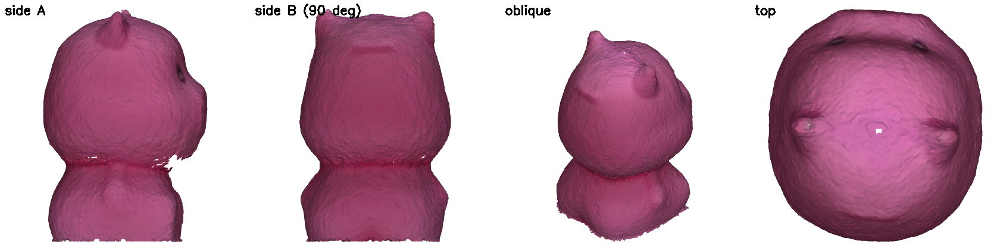

# 3D Scan Bot — 개발 보고서

- 과제: Pinky Pro 2대에 RealSense D455를 서로 다른 높이로 달고, 두 대가 물체 둘레를 함께 돌며 찍은 스냅샷으로 물체의 3D 메시를 만든다.
- 기간: 2026-11-18(주제 확정) ~ 2026-11-24(이 보고서 기준)
- 기준 커밋: main `27b5340`
- 시연: 2026-11-28(토)
- 저장소 기여(git 작성자): konor123, jaehyeonkim, demyank(main), fmv3654(합쳐지지 않은 브랜치 `feat/sim-wheel-moves`)

## 1. 요약

- 두 로봇 엇갈림 스캔이 실물에서 처음부터 끝까지 성공했다(2026-11-23, 실행 `20261123-211555`, 결과 사본 `out/scan_20261123-211555/`). 명령 하나로 두 로봇이 판 반대편에서 출발해 각자 24시점을 찍었다. 스캔 PC는 48장을 한 TSDF 격자로 합쳐 메시를 만들었다. 걸린 시간은 241 s이고, 건너뛴 시점·거리 보정·정지는 0이다.
- 2026-11-21의 이전 방식(두 로봇이 시점마다 차례로 찍음)은 358 s였다. 엇갈림 촬영과 대기 시간 단축으로 117 s(33 %) 줄었다.
- 온라인에서 먼저 끝낸 것: 모듈 명세 12개, 테스트 먼저 쓴 구현, 가짜 로봇 2대 통합(I1), Gazebo 시험(I2). Gazebo에서 180 × 140 × 160 mm 상자를 186.0 × 144.0 × 160.3 mm로 재구성했고, 원 경로 장애물 우회도 통과했다.
- 자동 테스트 279개가 모두 통과한다(오래 걸리는 통합 시험 포함, 2026-11-24 측정, 8.1절).
- 남은 일: 실물 기준 상자 치수(±1 cm) 확인, 시연 물체 스캔, 리허설 3회 연속 성공, 속도 변경(`27b5340`)을 모두 적용한 한 바퀴의 시간 측정(예상 약 185 s, 8.3절).



주요 용어:

| 용어 | 뜻 |
|---|---|
| L, H | 카메라를 낮게 단 로봇(L, 바닥 위 0.15 m)과 높게 단 로봇(H, 0.45 m). L은 물체 아래쪽 옆면, H는 위쪽 옆면과 윗면을 맡는다. |
| 표식 판 | 물체를 놓는 바닥 판. 둘레의 AprilTag 표식으로 사진마다 카메라 위치와 방향(자세)을 구한다. |
| 시점 | 촬영 위치. 로봇마다 물체 둘레 원 위 24곳(15° 간격)에서 멈춰 한 장씩 찍는다. |
| 엇갈림 촬영 | 한 로봇이 찍는 동안 다른 로봇은 다음 시점으로 움직이는 진행 방식(6.3절) |
| `d` | 카메라에서 물체 바깥 경계까지의 수평 거리. 목표 0.45 m, 허용 0.40 ~ 0.55 m |
| TSDF | 여러 깊이 사진을 작은 정육면체 칸(복셀)에 누적해 표면을 찾는 재구성 방법(6.4절) |
| I1, I2 | 온라인 통합 시험. I1은 가짜 로봇 2대(개발 PC), I2는 Gazebo 시뮬레이션이다. |

## 2. 과제 선정 경과

과제는 태양광 패널 청소 로봇, 로봇 2대 게임, 3D 스캔 봇 순으로 바뀌었다. 이전 과제의 계획서는 `docs/archive/`에 있다.

- **태양광 패널 청소 로봇(2026-11-16, `docs/archive/panel-bot/`)**: Pinky Pro 1대의 기본 RGB 카메라로 모형 패널 위에서 단안 Visual SLAM(ORB-SLAM3)·경계 검출·왕복 주행을 하는 계획서 v3.0에서 출발했다. 검토를 거쳐 v4.x와 v5.0을 만들었다. 마지막 SW 계획서 v6.0은 카메라와 SLAM을 빼고, 바닥 IR 3채널 낙하 방지와 IMU·엔코더 기반 평행 왕복 주행으로 단순화했다.
- **로봇 2대 게임(2026-11-16 ~ 11-17, `docs/archive/two-robot-games/`)**: 술래잡기 v1.0(YOLO·Nav2·초음파)에서 출발했다. 로봇에 `ultralytics`·`torch`·Hailo가 없어 꼬리 LED 추적과 LiDAR 회피를 쓰는 꼬리잡기 v1.0으로 바꿨다. 이어 M5Stack ATOM Lite + IR Unit으로 피격을 판정하는 IR 대전 v1.0을 설계했다.
- **3D 스캔 봇(2026-11-18부터)**: D455를 서로 다른 높이로 단 Pinky Pro 2대로 표식 판 위 물체를 스캔하는 계획서 v2.0(`docs/archive/scan-bot/SCAN-PLAN-v2.0.md`)을 썼다. 다음 날 지금의 개발 계획서(`docs/plan/PLAN.md`)로 다시 정리했다. 달라진 점은 5장 끝에 적었다.

## 3. 목표와 요구 조건

시연 장면: 표식 판 가운데에 물체를 놓고 스캔 PC에서 명령 하나를 실행하면, 두 로봇이 서로 반대편에서 함께 물체를 한 바퀴(24시점) 돌며 찍고, 스캔 PC 화면에 색이 있는 3D 메시가 뜬다(`docs/plan/PLAN.md` 1장).

| 완료 기준(PLAN 1장) | 현재 상태 |
|---|---|
| 명령 하나로 두 대 동시 한 바퀴부터 메시 표시까지 15분 안 | 실물 두 대에서 시작부터 메시 파일 생성까지 241 s. 메시 창까지의 시간은 리허설에서 확인 |
| 기준 상자 치수 오차 ±1 cm | Gazebo 달성(+6.0, +4.0, +0.3 mm). 실물 기준 상자는 미완 |
| 메시에 겹친 벽 없음 | 분홍 피규어에서 L·H가 한 겹으로 이어짐(목 아래 이음새에 작은 틈). 기준 상자는 미완 |
| 모든 시점에서 카메라–물체 거리 0.40 m 이상 | 달성. 실물 두 대에서 원 진입 뒤 융합한 시점 모두 L 0.426 ~ 0.445 m, H 0.455 ~ 0.470 m |
| 원 경로의 작은 상자 앞에서 멈춘 뒤 비켜 가서 한 바퀴를 마침 | Gazebo 달성. 실물 장애물 시험 결과는 기록이 없다 |

과정에서 정한 조건:

- 로봇은 센서 원자료를 보내기만 하고, 처리는 모두 스캔 PC가 한다. 영상은 스트림 없이 스캔 PC가 요청할 때만 스냅샷으로 받는다(4.2절, 5장).
- 로봇은 카메라 높이와 각도를 바꿀 수 없다. 그래서 두 로봇에 높이가 다른 카메라를 하나씩 단다(4.1절).
- 물체는 바닥 윤곽이 지름 0.28 m 원 안, 높이 0.20 m 이하다.
- 주행은 카메라를 깊이 최소 거리 밖에 두고, 원 경로의 장애물을 피한다(6.2절).
- 시연용 과제이므로 엄격한 기준보다 성공 경로를 먼저 구현하고, 현장에서 실제로 난 문제만 고친다.
- 재료는 다이소 제품(상자, 기둥)과 바닥에 펴 놓는 표식 용지(A1 출력)다.

## 4. 시스템 구성

### 4.1 하드웨어와 배치

| 항목 | 배치와 기준값 |
|---|---|
| 로봇 | Pinky Pro 2대. Raspberry Pi 5(RAM 2 GB), Ubuntu 24.04, ROS 2 Jazzy. 차체 110 × 120 × 142 mm, 맨 위에 RPLiDAR C1(주사면 바닥 위 약 0.125 m) |
| 카메라 | RealSense D455 2대. 깊이 848 × 480 Z16(최소 깊이 0.35 m, 측정 범위 0.4 m 이상), 컬러 1280 × 720 YUY2, 15 fps |
| 높은 시점 H | `pinky1`에 D455를 바닥 위 0.45 m에 달고 아래로 37° 기울인다. 위쪽 옆면과 윗면을 본다. |
| 낮은 시점 L | `pinky2`에 D455를 바닥 위 0.15 m에 달고 아래로 15° 기울인다. 아래쪽 옆면과 가까운 표식을 본다. |
| 카메라 방향 | 두 카메라 모두 차체 뒤쪽 기둥에 가로로 단다. 진행 방향의 왼쪽 90°를 보므로 반시계로 돌 때 판 가운데를 향한다. |
| 표식 판 | A1 무광 출력물(594 × 841 mm)에서 594 × 594 mm를 잘라 평평한 바닥에 펴 놓고 가장자리만 테이프로 고정한다. 한 변 85 mm인 AprilTag 36h11 표식 16개가 물체를 둘러싼다. |
| 물체 | 바닥 윤곽이 지름 0.28 m 원 안, 높이 0.20 m 이하. 판 가운데에 놓는 오차는 0.03 m까지로 잡는다. |
| 촬영 원과 시점 | 판 중심에서 카메라까지의 수평 반지름 `R`은 0.62 m다. 로봇마다 15° 간격으로 24시점씩 찍어 두 높이에서 48시점을 얻는다. |
| 바닥 | 바깥 우회 차선을 포함해 약 2.2 × 2.2 m의 빈 공간 |

값의 근거(PLAN 3.1):

- **거리**: 848 × 480 깊이의 최소 거리 0.35 m가 물리적 한계이고, 측정 범위 0.4 m를 하한으로 쓴다. 목표는 0.45 m다.
- **원 반지름**: 물체를 바닥 윤곽 원(반지름 0.14 m)에 놓는 오차 0.03 m를 더한 유효 반지름 `r_eff` 0.17 m로 본다. `R = r_eff + 0.45 m = 0.62 m`라서 상자 모서리가 카메라 쪽을 향해도 거리가 0.45 m다.
- **H 각도**: 37°는 판 가운데 바닥을 겨누는 각(`atan(0.45/0.62)` ≈ 36°)에 맞춘 값이다. 높이 0.20 m 물체의 윗면 가운데를 약 22°로 내려다본다.
- **판 크기**: 판 모서리(중심에서 0.42 m)가 로봇 안쪽 바퀴 경로(약 0.585 m) 안에 들어 로봇이 판을 밟지 않는다.

### 4.2 소프트웨어 구조

로봇은 카메라 원자료, LiDAR 거리, 바퀴 주행거리계(odom)와 주행 상태를 보낸다. 모터 구동, odom 계산, 이동 명령 실행은 로봇에 남긴다. 표식 검출, 주행 경로와 장애물 판단, 영상 처리, 두 로봇의 데이터 융합은 스캔 PC가 맡는다.

| 실행 위치 | 모듈 | 역할 |
|---|---|---|
| 로봇 | `ros/scan3d_robot`의 `robot_agent` | D455를 열어 공장 보정값과 촬영 바이트를 보내고, TCP 명령을 로봇 안 ROS 주행 명령으로 전달한다. |
| 로봇 | `robot_scan.launch.xml` | `pinky_auto`의 로봇 런치, `command_driver`, `robot_agent`를 함께 띄운다. |
| 로봇 | `ros/pinky_auto` | 모터 드라이버와 LiDAR를 띄운다. 속도 명령이 끊기면 바퀴를 멈춘다. 스캔에 쓰지 않는 순찰·초음파 따라가기 노드도 들어 있다. |
| 로봇 | `pinky_sim_examples`의 `command_driver` | `turn`·`forward` 문장 명령을 odom으로 확인하며 실행하고 완료 상태를 보낸다. 스캔 런치는 자체 장애물 정지 거리를 0으로 둔다. |
| 스캔 PC | `scan3d/station.py`, `protocol.py`, `dataset.py` | 스캔을 시작하고 TCP 메시지와 원자료를 기록한다. 역할별 데이터셋을 만든 뒤 융합을 호출한다. |
| 스캔 PC | `scan3d/robot/` | `link`가 한 로봇과 통신한다. `align`과 `tagpose`가 깊이 정렬과 자세 추정을, `drive`와 `unit`이 주행·촬영·재촬영을 맡는다. |
| 스캔 PC | `scan3d/pair/` | `coordinator`가 두 로봇의 출발 간격과 촬영 차례를 맞춘다. `recon`이 두 높이의 사진을 하나의 메시로 합친다. |
| 개발 PC·스캔 PC | `scan3d/sim/` | `sim2d`의 주행·LiDAR와 `synth`의 합성 영상으로 실물과 같은 TCP 접점을 내는 가짜 로봇 |
| 개발 PC·스캔 PC | `tools/` | 표식 판·각도기 인쇄 파일을 만들고, 로봇 연결·자세·스냅샷·LiDAR·주행을 점검하고, 스캔을 실행한다. |
| 개발 PC·스캔 PC·시뮬레이션 PC | `scripts/` | 환경 설치, 로봇 배포·기동, 시뮬레이션 실행 |
| 스캔 PC | `docker/` | 스캔 PC 환경을 컨테이너로 꾸린다(amd64·arm64). |
| 시뮬레이션 PC | `ros/scan3d_sim` | Gazebo에 방과 로봇을 띄우고, 가상 RGB-D 카메라의 영상·보정값을 같은 스냅샷 접점으로 내보낸다. |

여러 Pinky Pro를 한 공유기에 물리면 ROS 2 DDS 트래픽으로 통신이 끊길 수 있다. 그래서 `scripts/robot.sh`가 스캔 스택을 띄울 때 로봇별 `ROS_DOMAIN_ID`(L 11, H 12)와 `ROS_AUTOMATIC_DISCOVERY_RANGE=LOCALHOST`를 넣어 ROS 통신을 로봇 안에 둔다. 로봇 밖으로는 TCP 메시지만 오간다.

### 4.3 데이터 흐름

| 연결 | 스캔 PC → 로봇 | 로봇 → 스캔 PC |
|---|---|---|
| TCP 7010 · 제어 | `hello`로 촬영 형식을 정하고 `move`, `snapshot`을 요청한다. | `hello`에는 역할·카메라 일련번호·공장 보정값을, `move`에는 완료·정지 여부와 odom을 돌려준다. `snapshot`에는 촬영 시각과 odom이 든 JSON 머리말 뒤에 영상 바이트가 붙는다. 실패 응답은 `ok:false`와 오류 사유를 담는다. |
| TCP 7011 · 스트림 | `stop`으로 현재 이동을 멈추고 `abort`로 스캔을 중단한다. | `odom`은 위치·방향, `scan`은 LiDAR 거리, `status`는 주행 명령 상태를 보낸다. 스냅샷 응답을 기다리는 동안에도 이 연결로 정지시킬 수 있다. |

1. 스캔 PC가 `hello`로 두 센서의 내부 파라미터·왜곡 계수, 깊이 센서에서 컬러 센서로의 회전·이동, 깊이 단위 환산값을 받는다. 로봇은 이때 카메라를 잠시 켜서 보정값을 읽고 다시 끈다.
2. 로봇이 시점에 도착하면 0.3 s(`settle_s`) 기다린 뒤 스캔 PC가 스냅샷을 요청한다. 로봇은 D455를 15 fps로 켜고, 노출이 안정되도록 처음 5세트(`n_skip`)를 버린다. 컬러 1280 × 720 YUY2 한 장과 깊이 848 × 480 Z16 세 장을 모아 스트림별로 무손실 압축해 보낸다(현재 설정. 2026-11-23 실물 실행은 깊이 5장·압축 없음).
3. 스캔 PC는 원자료를 역할별 `raw/`에 보관한다. 각 스냅샷에서 깊이 중앙값·정렬과 컬러 왜곡 보정을 거친 뒤 표식으로 카메라 자세를 구한다. 주행 중에는 이 자세로 다음 이동과 거리 보정을 판단한다.
4. 주행이 끝나면 저장한 원자료를 다시 처리한다. 같은 시점에 다시 찍은 사진이 있으면 최신 것부터 보고 표식 자세를 구한 한 장을 고른다. 역할별로 컬러 JPEG, 정렬 깊이 PNG, 내부 행렬, 시점별 자세와 품질값을 저장한다.
5. L과 H의 유효 시점을 판 좌표계에서 잘라 하나의 TSDF 격자에 융합한다. 결과는 `scans/<실행 ID>/out/`에 `mesh.ply`(삼각형 메시), `cloud.ply`(점구름), `report.txt`(치수·시점별 결과)로 남긴다.

스냅샷 1회는 원본 약 4.3 MB(컬러 1.84 MB + 깊이 0.81 MB × 3)이고, 압축하면 약 1.6 MB다. 한 바퀴 48회로 약 80 MB다. 영상을 15 fps로 계속 받으면 초당 약 69 MB이므로 스냅샷 방식을 택했다. odom·LiDAR 스트림은 로봇당 초당 수십 KB다.

## 5. 개발 방식

현장(로봇 옆)에서 쓸 수 있는 시간이 짧다. 그래서 온라인에서 다 만들어 두고, 현장에서는 장착·확인·촬영만 하도록 계획했다.

| 원칙 | 내용 |
|---|---|
| 명세 먼저(SDD) | 코드 전에 모듈마다 1쪽 명세(`docs/specs/`, 12개: 입력·출력·동작·완료 테스트)를 썼다. 모듈 사이 접점(좌표, 스냅샷, 메시지, 데이터셋, 설정)은 PLAN 4장에서 먼저 확정했다. |
| 테스트 먼저(TDD) | 명세의 완료 테스트를 먼저 쓰고 통과시켰다. 로봇 대신 가짜 에이전트, 카메라 대신 합성 영상(`synth`), 실제 주행 대신 2D 시뮬레이터(`sim2d`)를 끼워 개발 PC에서 전체 흐름을 통과시켰다. |
| 개발 PC → Gazebo → 실물 | 가짜 로봇 2대 통합(I1) → Gazebo 시험(I2) → 로봇 원격 설치 → 현장 순서로 진행했다. |
| 온라인과 현장 구분 | `docs/plan/TODOs.md`가 일을 [온라인]과 [현장]으로 나눈다. 현장 항목마다 명령 하나, 성공 출력, 실패 때 할 일 한 줄을 적었다. |
| 설정 하나 | 현장에서 바꾸는 값은 `config/scan.yaml` 하나에 모았다. 현장에서 코드를 고치지 않는다. |
| 원자료 보관 | 스캔 PC는 로봇에서 받은 원본을 그대로 저장한다. 개발 PC에서 원자료로 재생 테스트(`tests/replay`)를 돌리고, 역할별 데이터셋을 지금 설정으로 다시 합친다(`python -m scan3d.pair.recon`). |
| 공개 예제 활용 | 로봇 구동(`pinky_pro`), 문장 명령 주행(`pinky_sim_examples`의 `command_driver`), 스냅샷과 정렬(librealsense Python 예제), TSDF 융합(Open3D `integrate.py`), 표식(OpenCV `aruco`)을 출발점으로 썼다(PLAN 2장 표). |

작업 장소는 역할로 나눴다.

| 장소 | 하는 일 |
|---|---|
| 개발 PC | 명세, 코드, 테스트, 현장 데이터 재처리 |
| 시뮬레이션 PC | Gazebo 시험(Ubuntu 24.04, ROS 2 Jazzy) |
| 스캔 PC | 현장 실행. 저장소를 clone해 `scripts/setup_station.sh` 또는 Docker(`docker/`)로 환경을 만든다. 두 로봇과 같은 Wi-Fi에 있다. |
| 로봇 2대 | 구동 스택과 `robot_agent`. `scripts/deploy.sh`로 배포하고 `scripts/robot.sh`로 켜고 끈다. |

팀원은 같은 Wi-Fi의 노트북에서 SSID로 로봇 주소를 찾아(`scripts/ssh_aliases.sh`, `tools/find_robots.py`) 두 로봇에 바로 붙는다. 한 로봇을 두 곳에서 동시에 구동하지 않도록 `robot.sh`가 이미 떠 있는 구동 스택을 확인한다.

이전 계획 v2.0(2026-11-18)에서 바뀐 점:

| 항목 | v2.0 | 지금(PLAN.md) |
|---|---|---|
| 로봇이 하는 일 | 원 추종 주행, 표식 자세, 깊이 중앙값, 정지 판단, 영상 저장 | 센서 원자료 전달과 `command_driver` 문장 실행만. 나머지는 스캔 PC로 옮겼다. 재구성은 두 계획 모두 스캔 PC가 한다. |
| 영상 | 시점마다 깊이·컬러 10장을 로봇에 저장하고, 로봇이 만든 시점별 결과(중앙값 깊이, 컬러 1장, 자세)를 스캔이 끝난 뒤 옮김 | 스캔 PC가 요청할 때만 카메라를 켜 스냅샷 원자료를 바로 받고 그대로 보관 |
| 검증 | 벤치·현장에서 차례로 측정(M1 ~ M5) | 명세·테스트 먼저, I1·I2로 온라인에서 전체 흐름을 통과시킨 뒤 현장 |
| 장애물 | 진행 방향에 무엇이 있으면 멈추고 30 s 뒤 중단 | 5 s 기다린 뒤 바깥 차선(`R` + 0.25 m)으로 비켜 가고 원으로 복귀 |
| 표식 판 | 한 변 50 mm 표식 약 40장 | 한 변 85 mm 표식 16장 |

## 6. 핵심 기술

### 6.1 표식 판과 카메라 자세

판 중심의 인쇄면을 원점, 인쇄된 0° 화살표를 +x축, 위쪽을 +z축으로 삼는다. 표식은 중심 간격 115 mm인 5 × 5 격자의 바깥 16칸에 놓는다. ID는 y가 작은 행부터, 각 행에서는 x가 작은 순서로 0 ~ 15를 매긴다. 가운데 3 × 3칸은 물체 자리로 비운다. 물체가 일부 표식을 가려도 남은 표식으로 같은 좌표계를 본다. 배치 파일(`config/board.json`)에는 각 표식의 네 모서리를 m 단위로 저장한다.

인쇄 배율은 현장에서 잰다. 잘라서 바닥에 편 뒤 가로·세로 각각 바깥 표식 끝에서 끝까지 잰다(설계 545 mm). 두 값의 차이가 2 mm를 넘으면 다시 출력한다. 평균값으로 config `board.tag_mm`를 고치면 모든 모서리 좌표가 같은 비율로 바뀐다.

왜곡을 편 컬러 영상에서 표식을 찾는다. 검출 모서리의 x·y에서 각각 0.5 px를 빼고, 판에 없는 ID나 영상 경계에서 2 px 안에 모서리가 있는 표식은 뺀다. 서로 다른 표식이 2개 이상이면 모든 유효 모서리의 판 좌표와 영상 좌표로 PnP를 한 번 푼다(`cv2.solvePnP`, 반복법). 결과 `T_cam_board = [R | t]`는 판의 점을 카메라 좌표로 옮긴다. 대응점을 영상에 다시 투영해 검출 모서리까지 거리의 제곱평균제곱근을 시점별 품질 지표 `reproj_px`로 기록한다. 실제 두 로봇 스캔(`20261123-211555`)에서 이 값은 H 0.861 ~ 1.290 px, L 1.118 ~ 1.758 px였다.

판 좌표에서 카메라 위치는 `−Rᵀt`다. 주행에는 광축을 바닥에 투영한 방향에서 장착각 90°를 빼 차체 방향을 구한다. 카메라 위치에서 장착 위치 (−0.08 m, 0 m)를 그 방향으로 돌려 빼면 차체 중심이 나온다. 높이와 피치는 촬영 배치에 쓰고, 재구성에는 사진에서 직접 구한 `T_cam_board`를 쓴다.

### 6.2 주행

`d`는 카메라에서 판 중심까지의 수평 거리에서 `r_eff`(물체 반지름 0.14 m + 놓는 오차 0.03 m = 0.17 m)를 뺀 값이다. 촬영 원 위에서는 `d = 0.62 m − 0.17 m = 0.45 m`다. 허용 범위는 0.40 ~ 0.55 m다. 표식이 보일 때마다 촬영 순간의 odom을 기준으로 차체 자세를 고치고, 다음 표식까지는 odom 변화량을 더한다. 촬영 때 표식이 부족하면 odom으로 거리를 추정한다. 범위 밖이면 같은 각도의 촬영 원으로 한 번 이동해 다시 찍는다.

로봇은 다음 시점을 향해 회전한 뒤 원의 현을 따라 직진한다(현재 0.10 m/s). `27b5340`부터 일반 시점 이동에서는 진행 방향 그대로 선다. 그 방향에서 카메라가 원 위에 오도록 차체 종점을 옮겨, 시점마다 하던 마지막 회전을 없앴다. 목표까지 0.02 m 미만이면 방향만 맞춘다. 촬영 원 진입, 거리 보정, 우회 뒤 복귀에서는 접선 방향까지 회전한다.

| 상황 | 판단과 동작 |
|---|---|
| 직진 출발·정지 | LiDAR 장착 방향 180°를 보정한 뒤 진행 방향 ±25° 부채꼴의 최소 거리를 쓴다. 0.30 m 이상일 때 출발하고, 주행 중 0.20 m 미만이면 멈춘다. |
| 카메라 기둥 가림 | 기둥에 가린 뒤쪽 각도는 `tools/lidar_view.py`로 확인해 `lidar.mask`에 적고 판단에서 뺀다. 앞쪽 ±25°는 비어 있어야 한다. |
| 낮은 물체 | 주사면(바닥 위 약 0.125 m)보다 낮은 케이블·물체는 LiDAR에 보이지 않는다. 스캔 전에 원 경로 주변 바닥을 치운다. |
| 일시 장애물 | 멈춘 자리에서 길이 열리는지 본다. 5 s 안에 열리면 현재 자세에서 경로를 다시 계산한다. |
| 우회·건너뛰기 | 시점 이동이 5 s 동안 막히면 반지름이 0.25 m 더 큰 바깥 차선으로 간다. 시점마다 원래 원으로 돌아오기를 시도하고, 복귀가 막힌 시점은 건너뛴다. |
| LiDAR 끊김·시간 초과 | 마지막 LiDAR 스캔이 0.5 s보다 오래되면 출발하지 않거나 직진을 멈춘다. 스캔 끊김이나 진입·거리 보정·바깥 차선의 막힘이 60 s 이어지면 중단한다. 응답 한도는 `hello`·스냅샷 30 s, 이동 명령 60 s다. |
| 실패·연결 끊김 | 한 로봇에서 오류가 나면 스캔 PC가 두 로봇 모두에 `abort`를 보내고, 로봇은 다음 `hello`까지 이동 명령을 거절한다. 제어 연결이 끊기면 로봇은 실행 중인 구간 하나(최대 약 0.25 m)를 마치고 선다. |

### 6.3 두 대 엇갈림 촬영

L과 H를 판의 반대편에 둔다. 출발 사진에서 구한 두 카메라의 방위각 차이가 180° ± 30° 안인지 확인한 뒤 같은 반시계 방향으로 진입한다. 각 로봇은 자기 출발각을 기준으로 다음 시점을 잡는다.

`e666296` 전에는 두 로봇이 같은 시점 번호로 함께 이동한 뒤 L, H 순으로 찍었다. 상대가 찍는 동안 먼저 끝난 로봇도 서 있었다. 지금은 로봇마다 스레드 하나가 주행과 촬영을 맡는다. 한쪽이 찍는 동안 다른 쪽은 다음 시점으로 움직인다. 단, 상대가 시점 k−1에 도착해야 시점 k로 출발한다(한 시점 앞섬 제한).

스캔 PC는 두 스레드가 함께 쓰는 촬영 잠금을 두고, 한 번에 한 로봇에만 스냅샷을 요청한다. 로봇은 찍을 때만 카메라를 켜고 다 찍으면 끈다. 카메라가 꺼진 동안에는 그 카메라의 적외선 투사기도 꺼진다고 보고, 상대 로봇의 점 무늬가 깊이 사진에 섞이지 않게 했다. 거리 보정 주행 중에는 잠금을 놓고 다시 찍을 때 다시 잡는다. 투사기가 실제로 꺼지는지 확인하는 현장 시험은 미완이다.

### 6.4 정렬과 재구성

1. **깊이 중앙값**: Z16을 공장 환산값으로 mm 단위로 바꾼다. 픽셀마다 0을 뺀 값의 중앙값을 구한다(짝수 개면 가운데 두 값의 평균을 반올림). 유효값이 장수의 절반(올림)보다 적으면 0으로 둔다. 깊이 3장이면 유효값 2개, 2026-11-23 실행의 5장이면 3개가 필요하다.
2. **컬러·깊이 정렬**: librealsense의 소프트웨어 장치(`rs.software_device`)에 두 센서의 내부 파라미터와 깊이→컬러 변환을 등록한다. 중앙값 깊이를 `rs.align(rs.stream.color)`로 컬러 격자에 옮기고, 깊이값도 컬러 카메라 기준 z로 바꾼다. 마지막에 같은 왜곡 보정 지도로 컬러는 선형 보간, 깊이는 최근접 보간한다.
3. **가장자리와 바닥 지우기**: 3 × 3 이웃의 최대·최소 깊이 차이가 `edge_mm`(10 mm)를 넘거나 이웃에 0이 있으면 그 픽셀을 지운다. 남은 점을 판 좌표로 옮겨 수평 반지름 0.20 m 안, 높이 0.005 m(`floor_cut`) 초과 0.23 m 이하인 점만 남긴다. `floor_cut` 아래는 판 표면으로 보고 버린다.
4. **형상과 색 융합**: 각 시점의 깊이·색·표식 자세를 복셀 한 변 2 mm, 절단 거리 6 mm인 TSDF 격자에 누적한다(Open3D `VoxelBlockGrid`). 격자에서 삼각형 메시와 점구름을 꺼내고, 메시는 가장 큰 덩어리만 남긴다. `color_opt_iter`(기본 0)를 양수로 두면 융합에 쓴 사진으로 카메라 자세를 다듬어 꼭짓점 색을 다시 입힌다.
5. **치수**: 높이는 꼭짓점의 최대 z, 가로·세로는 `floor_cut` 위 꼭짓점을 감싸는 최소 면적 직사각형(`cv2.minAreaRect`)의 두 변이다.

저장한 L·H 데이터셋은 다음 명령으로 다시 합친다. 같은 스캔의 두 폴더를 주면 결과는 그 스캔의 `out_recon/`에 생긴다. 원래 폴더는 바꾸지 않는다.

```bash
python -m scan3d.pair.recon scans/20261123-211555/L scans/20261123-211555/H
```

## 7. 개발 경과

날짜는 한국 시간이다. 시험 수치는 8장, 문제와 해결은 9장, 전체 커밋은 부록 B에 있다.

### 2026-11-18 — 주제 확정과 계획 v2.0

- 주제를 3D 스캔 봇으로 정하고 계획서 v2.0을 썼다(`docs/archive/scan-bot/SCAN-PLAN-v2.0.md`). 초기 카메라 값은 L 0.20 m·10°, H 0.50 m·37°였다.
- 바닥 표식 판으로 카메라 자세를 구하고, 두 로봇이 180° 간격으로 원을 돌며 번갈아 찍고, 로봇과 스캔 PC 사이는 TCP로 잇는 기본 구조를 정했다.
- 다이소 준비물(기준 상자 품번 1050541, 카메라 기둥용 셀카봉 1048388)을 골랐다.

### 2026-11-19 — 개발 계획 확정과 저장소 시작

- 개발 계획서(`docs/plan/PLAN.md`)와 할 일 목록(`docs/plan/TODOs.md`)으로 저장소를 시작했다(`a816279`).
- 로봇은 수집·전달만, 처리는 스캔 PC, 스트림 없는 스냅샷, SDD·TDD 개발 방식을 확정했다.
- 이전 과제 문서(`docs/archive/`), Pinky Pro 구동 패키지(`ros/pinky_auto/`), 배포·실행 스크립트를 넣었다.

### 2026-11-20 — 명세, 표식 판, 전체 구현, 온라인 통합

- 문서의 PC 표기를 역할 이름으로 통일하고 로봇 접속 방법을 제조사 방식으로 정리했다(`78b4926`).
- 모듈 명세 12개와 표식 판(85 mm × 16장, `out/board_A1.pdf`)을 만들었다. 물체 높이 상한 0.20 m, H 카메라 0.45 ~ 0.50 m·35 ~ 40°로 계획을 고쳤다(`b43882a`).
- 스캔 PC 모듈(`scan3d/`), 로봇 에이전트(`ros/scan3d_robot/`), Gazebo 시험 패키지(`ros/scan3d_sim/`), 현장 도구(`tools/`), 설치 스크립트를 테스트 먼저 방식으로 구현했다(`6bad819`).
- I1(가짜 로봇 2대)과 I2(Gazebo)를 통과해 TODOs 1·2장을 마쳤다(8.2절).

### 2026-11-21 — 실물 연동과 두 대 운용

- 로봇 설치 스크립트에 USB 전류 한도 설정을 넣고, 첫 로봇에 D455를 설치했다(`4b4630e`).
- jaehyeonkim이 스냅샷 전송 끊김을 고치고(`57c2dc6`), macOS에서도 스크립트가 돌게 했다(`1d2389a`). 스캔 PC 코드를 로봇 1대 단위(`scan3d/robot/`)와 두 대 합침(`scan3d/pair/`)으로 나눴다(`de65161`).
- jaehyeonkim이 스캔 PC Docker 환경을 만들고(`1d28bd3`), `pinky_auto`에 초음파로 앞 로봇을 따라가는 노드를 넣었다(`1a13880`).
- 카메라 숙임 각도기를 만들었다(`d618133`). 실과 클립 추로 피치를 읽는 A4 접이식 종이 도구다(`out/angle_gauge_A4.pdf`).
- 카메라 장착을 확정했다: H = `pinky1`(SSID `pinky_d52c`, 0.45 m·37°), L = `pinky2`(SSID `pinky_6437`, 0.15 m·15°)(`652ea2a`).
- SSID로 로봇 주소 찾기, 구동 겹침 방지, LED 동시 확인을 넣고 두 로봇을 한 스캔 PC에서 함께 제어했다(`7625910`).
- demyank가 첫 현장 스캔 결과를 올렸다. L 한 대 274 s, 두 대 차례 촬영 358 s였다(`553181a`).
- 두 대가 더 느린 원인을 분석해 엇갈림 촬영을 넣고, 멈춘 뒤 대기와 노출용 버림 프레임을 줄였다(`e666296`).
- fmv3654가 별도 브랜치(`feat/sim-wheel-moves`)에 Gazebo 바퀴 이동 명령을 만들었다(`3db096d`, main에 합치지 않음).

### 2026-11-23 — 화질 개선, 두 대 엇갈림 스캔 첫 성공, 속도 개선

- 재구성 화질을 손봤다: 복셀 3 → 2 mm, 바닥 자르기 3 → 5 mm, 가장자리 깊이 지우기, 색 다시 입히기(기본 끔), 다시 합치기 명령(`6da7b31`, `b84bc85`).
- 두 대 엇갈림 스캔에 처음 성공하고 결과를 `out/scan_20261123-211555/`에 올렸다(`12779a5`, 8.3절).
- TODOs에 현장에서 배운 출발 조건과 대처를 적었다(`b3178e2`).
- 한 바퀴 시간을 분석해 직진 속도, 깊이 장수, 압축, 마지막 회전을 바꿨다(`27b5340`).

## 8. 시험과 결과

### 8.1 자동 테스트

| 시험 묶음 | 확인하는 내용 |
|---|---|
| 빠른 테스트 | `-m "not slow"`로 고른다. 환경·통신 형식, 표식 배치·자세, 깊이 정렬, 데이터셋 저장, 이동 명령과 장애물 대응을 검사한다. |
| 오래 걸리는 테스트(`slow`) | 합성 48시점 재구성, 두 로봇 촬영 순서·우회·재촬영, 현장 점검 도구, I1 전체 흐름을 검사한다. |
| ROS 패키지별 `test/` | `pinky_auto`는 속도 명령이 끊길 때 정지·추종·순찰을, `scan3d_robot`은 가짜 카메라로 명령·원자료·중단을, `scan3d_sim`은 카메라 보정값과 프레임 포장을 검사한다. |
| 합성 데이터 `synth` | 크기·자세·색을 아는 물체와 판에서 컬러·깊이를 만든다. 자세와 융합 치수를 참값에 대조한다. |
| 2D 시뮬레이터 `sim2d` | 평면에서 차체 이동, odom, LiDAR 관측을 만들어 정지·재출발·우회 경로를 검사한다. |
| 가짜 로봇 | 두 대가 같은 가상 공간을 쓰고 실물과 같은 TCP 메시지로 응답한다. I1은 장애물이 있을 때와 없을 때 스캔 시작부터 메시의 치수와 색까지 검사한다. |
| 원자료 재생 `tests/replay/` | 저장한 스냅샷의 길이·정렬 깊이·재투영 오차를 확인하고, 사본에서 데이터셋을 다시 만든다. 개발 PC의 `scans/`에 있는 실행을 읽는다. |

2026-11-24, main `27b5340`에서 `.venv/bin/python -m pytest -q`로 오래 걸리는 시험까지 모두 돌렸다. **통과 279개, 실패 0개, 건너뜀 0개**, 1,093 s였다.

재생 시험은 개발 PC에 있는 두 실행을 읽었다. I1 기록(`20261120-071129`)과 실제 두 로봇 기록(`20261123-211555`)에서 각각 스냅샷 50개를 읽고 데이터셋을 다시 만들었다. `scans/`는 저장소에 넣지 않으므로, 현장 원자료를 `tests/data/`에 고정하는 일은 남아 있다(10장).

### 8.2 시뮬레이션

**I1: 가짜 로봇 2대(개발 PC)**: `python -m scan3d.station --fake`가 가짜 에이전트 2대와 합성 영상으로 두 대 한 바퀴를 돌고 메시를 만든다. 180 × 140 × 160 mm 상자를 184.1 × 144.1 × 160.3 mm로 재구성했다(135.5 s, 실행 `20261120-071129`, 개발 PC 보관). 원 경로에 상자를 둔 경우(`--fake --obstacle 2`)도 한 바퀴를 마친다.

**I2: Gazebo(시뮬레이션 PC)**: 표식 판 텍스처를 깐 3 m 방에 같은 크기의 상자를 두고, D455를 옆으로 단 로봇을 L·H 설정으로 한 바퀴씩 돌렸다(`scripts/sim_scan.sh L|H [--obstacle]`, 2026-11-20). 당시 L은 0.20 m·10°였다.

| 시험 | 결과 | 치수(mm) | 시간 |
|---|---|---|---|
| L 한 바퀴 | 23/24시점 표식 자세(1시점 표식 없음), 시점당 표식 2 ~ 6장, 재투영 최대 2.43 px | 185.3 × 145.0 × 160.4 | 248 s |
| H 한 바퀴 | 24/24시점, 시점당 표식 10 ~ 14장 | 185.8 × 144.6 × 160.9 | 258 s |
| I2: L + H 합침 | L 23시점 + H 24시점 융합 | 186.0 × 144.0 × 160.3 | — |
| L 장애물 | 0.10 m 상자 앞에서 정지 → 5 s 대기 → 바깥 차선 우회 → 시점 3·4 건너뜀 → 원으로 복귀, `d` 0.450 ~ 0.464 m | 185.1 × 144.8 × 160.5 | 365 s |

- ROS 2 패키지 폴더 규칙에 맞춰 `ros/scan3d_sim/`으로 옮긴 뒤 다시 돌려 같은 결과를 얻었다(L 250 s, L 장애물 369 s, H 261 s, 합침 186.1 × 144.2 × 160.3 mm).
- Gazebo 카메라 기본값 640 × 360에서는 L이 바닥 표식을 거의 찾지 못해 1280 × 720으로 올렸다.
- 치수가 가로·세로로 4 ~ 6 mm 크게 나온다. I1에서 합성에 쓴 정답 깊이로 다시 재면 182.3 × 142.0 mm로 약 2 mm 줄어든다. 절반쯤은 깊이–컬러 정렬에서, 나머지는 TSDF 복셀(당시 3 mm)과 치수 재는 방식에서 오는 것으로 본다. ±1 cm 안이라 고치지 않았다.

### 8.3 실제 로봇

| 날짜 | 시험 | 결과 |
|---|---|---|
| 11-21 | 첫 로봇 D455 연결과 설치 | D455F가 USB 3(5000M)로 연결됨. venv에 `pyrealsense2`, udev 규칙, USB 전류 한도 1.6 A 설정 뒤 스트림 정상 |
| 11-21 | 스냅샷 전송 | 끊김 수정 뒤 3/3 성공, 평균 3.4 s(`57c2dc6`). 로봇 2도 스캔 PC에서 내부망으로 3/3, 1회 3.34 s |
| 11-21 | 두 대 동시 명령 | `tools/led_check.py` PASS, 두 로봇 응답 차 최대 41 ms(응답 최대 59 ms), 뒤 LED 동시 점등을 눈으로 확인 |
| 11-21 | 두 대 동시 스냅샷 | 3/3씩, L 평균 3.34 s·H 3.28 s. 한 대만 찍을 때보다 느려지지 않음 |
| 11-21 | Docker 스캔 PC 환경에서 L 한 바퀴 | 24시점, 250 s, 메시 생성(`1d28bd3`) |
| 11-21 | L 한 대 한 바퀴(분홍 인형) | 메시 생성, 274 s, 66 × 63 × 119 mm(`out/scan_L_run.log`) |
| 11-21 | 두 대 차례 촬영 한 바퀴(분홍 인형) | 메시 생성, 358 s, 115 × 104 × 126 mm(`out/scan_pair_run.log`, `out/scan_pair_preview.jpg`) |
| 11-23 | 노출 확인(`n_skip` 5) | L·H 모두 PASS 3/3, 평균 밝기 L 140·H 114, 1회 L 3.49 s·H 2.99 s |
| 11-23 | 두 대 엇갈림 한 바퀴(분홍 피규어, 11-21과 다른 물체) | 네 번째 시도에서 성공, 241 s(아래) |

**두 대 엇갈림 스캔(2026-11-23, 실행 `20261123-211555`, 결과 사본 `out/scan_20261123-211555/`, 원자료는 개발 PC 보관)**

| 항목 | L(`pinky2`, 0.15 m·15°) | H(`pinky1`, 0.45 m·37°) |
|---|---|---|
| 융합 시점 | 24/24 | 24/24 |
| 카메라–물체 거리 `d` | 0.426 ~ 0.445 m | 0.455 ~ 0.470 m |
| 시점당 표식 수 | 7 ~ 12 | 10 ~ 14 |
| 재투영 오차 | 1.12 ~ 1.76 px | 0.86 ~ 1.29 px |
| 깊이 무효 비율(평균) | 0.204 | 0.079 |
| 건너뜀·거리 보정·정지 | 0 | 0 |

- 메시 29,472 꼭짓점, 58,159 삼각형, 치수 138.0 × 127.8 × 202.7 mm(실물 치수는 재지 않음).
- 241.4 s = 출발 사진과 두 로봇의 원 진입 약 18.6 s + 24시점 촬영 약 206.5 s + 데이터셋 생성·재구성 약 16.3 s(실행 이벤트 기록). 촬영 사이 간격의 중앙값은 L 8.09 s, H 8.29 s다.
- 귀·눈·윗면 투입구가 보이고 L(아래쪽)과 H(위쪽·윗면)가 한 겹으로 이어졌다. 목 아래 이음새에 작은 틈이 있다.
- 11-21 그림의 흰 점은 점구름(`cloud.ply`)을 1픽셀 점으로 그린 탓이었다. 메시(`mesh.ply`)를 면으로 그리면 흰 점이 없다.
- 색 다시 입히기(`--color-opt 100`)는 11 s 더 걸리고, 거의 한 색인 물체에서는 차이가 작아 끈 채로 둔다(`out/scan_20261123-211555/compare_color_opt.png`).
- 앞의 세 번은 출발하지 못했다. 두 번은 H 가까이(앞 0.27 m, 옆 0.11 ~ 0.13 m)에 놓인 물건 때문에 H가 첫 보정 이동을 못 했고, 한 번은 H 출발 사진에 판이 없었다. 물건을 치우고 H를 다시 놓은 뒤 성공했다(9장).
- 이 실행은 직진 0.06 m/s, 깊이 5장, 압축 끔으로 돌았다. 그 뒤 설정을 바꿨다(직진 0.10 m/s, 깊이 3장, 압축, 마지막 회전 생략, `27b5340`). 실물에서는 스냅샷 시간만 쟀고(H 중앙값 3.43 s → 2.47 s), 모두 적용한 한 바퀴 시간은 아직 재지 않았다.

**속도 변경(`27b5340`) 뒤 예상 시간**

11-23 실행의 구간별 시간(시점당 중앙값)에 변경 효과를 더해 추정했다. 실측이 아니다.

| 구간 | 11-23 실측 | 바뀐 것 | 예상 |
|---|---|---|---|
| 시점 이동(회전 → 직진 → 회전) | L 4.44 s, H 4.53 s | 직진 0.06 → 0.10 m/s(0.162 m: 2.7 → 1.6 s), 마지막 회전 생략 | 2.5 ~ 3.0 s |
| 앞섬 제한 기다림 | L 0.36 s, H 0 s | — | 0 ~ 0.4 s |
| 멈춘 뒤 대기(`settle_s`) | 0.3 s | — | 0.3 s |
| 스냅샷(요청부터 수신까지) | L 2.94 s, H 3.29 s | 깊이 5 → 3장, 압축(4.3 MB → 약 1.6 MB). H 실측 중앙값 3.43 → 2.47 s | 2.5 ~ 3.0 s |
| **시점당** | **L 8.09 s, H 8.29 s** | | **약 5.3 ~ 6.7 s(가운데 약 6 s)** |
| 24시점 구간 | 206.5 s | 시점당 시간에 비례 | 약 135 ~ 170 s |
| 출발 사진·원 진입 | 18.6 s | 출발 스냅샷과 진입 이동이 조금 빨라짐 | 약 15 ~ 19 s |
| 데이터셋 생성·재구성 | 16.3 s | — | 약 16 s |
| **한 바퀴** | **241.4 s** | | **약 165 ~ 205 s(가운데 약 185 s, 약 3분)** |

- 가운데 값 기준으로 241 s보다 약 55 s(약 23 %) 짧다. 11-21 차례 촬영(358 s)과 비교하면 약 절반이다.
- 엇갈림이 유지된다는 가정이다. 한 로봇의 이동 + 대기(약 2.8 ~ 3.3 s)가 상대 로봇의 스냅샷(약 2.5 ~ 3.0 s)보다 길어야 서로 기다리지 않는다. Wi-Fi가 흔들려 스냅샷이 3.3 s를 넘으면 촬영 차례 기다림이 생기고, 시점당 시간은 스냅샷 두 번 길이에 가까워진다.

## 9. 문제와 해결

| 문제 | 원인 | 해결 | 커밋 |
|---|---|---|---|
| D455 USB 전류 부족 위험 | 로봇의 Pi 5가 3 A 전원으로 감지돼 USB 기기에 600 mA만 준다. D455는 USB에 720 mA를 선언한다. | `scripts/robot_root_setup.sh`가 `config.txt`에 `usb_max_current_enable=1`(1.6 A)을 넣고, `setup_robot.sh`가 재부팅 뒤 반영을 확인한다. | `4b4630e` |
| 약 6 MB 스냅샷 전송 중 연결 끊김 | 받기 대기 0.2 s를 소켓 전체 한도로 걸어 둔 채 `sendall`을 해서, Wi-Fi 버퍼가 잠깐 막히면 시간 초과로 끊었다. | 받기 대기를 `select`로 나누고 소켓 한도는 보내기용 30 s로 고정했다. 실물 3/3 성공, 평균 3.4 s | `57c2dc6` |
| macOS에서 로봇 스크립트 실패 | macOS 기본 `rsync`에 `--chmod`가 없고, bash 3.2의 `set -u`가 빈 배열을 정의되지 않은 변수로 보고 멈췄다. | 권한 설정을 `ssh chmod`로 나누고 빈 배열 처리를 고쳤다. 파이썬 경로를 `SCAN3D_PY`로 지정할 수 있게 했다. | `1d2389a` |
| 로봇 주소 변동과 구동 스택 중복 실행 | 공유기 DHCP로 로봇 주소가 바뀌고, 모터·LiDAR 직렬 포트를 이미 쓰는 프로세스가 있어도 시작할 수 있었다. | SSID로 주소를 찾아(`tools/find_robots.py`) 별칭을 갱신하고, `scripts/robot.sh`는 기존 프로세스가 있으면 시작하지 않는다. | `7625910` |
| `test_failure_stops` 간헐 실패(5회 중 3회) | 가짜 에이전트가 `abort`를 1 ~ 2 ms 늦게 기록하는데 테스트가 바로 읽었다. | 두 로봇의 기록을 최대 2 s 기다린 뒤 확인한다. 스캔 PC에서 15회 연속 통과 | `8b894bf` |
| 새 L 장착(0.15 m·15°)에서 스캔 PC 테스트가 출발하지 못함 | 테스트용으로 줄인 컬러 해상도 640 × 360에서 낮은 카메라가 표식을 0장 찾았다. | 테스트 컬러 해상도를 실제 크기 1280 × 720으로 올렸다(7 ~ 9장 검출). | `09ea9a2` |
| 두 대 스캔(358 s)이 한 대(274 s)보다 시점당 약 3.5 s 느림 | 두 로봇이 함께 이동한 뒤 차례로 찍어, 로봇마다 상대 촬영(약 3.3 s)만큼 더 섰다. 멈춘 뒤 대기 1.0 s와 버림 15프레임도 컸다. | 엇갈림 촬영(촬영 잠금 + 한 시점 앞섬 제한)으로 바꾸고 대기 0.3 s, 버림 5프레임으로 줄였다. 실물 241 s | `e666296` |
| 메시 윤곽의 색 번짐, 미리보기의 흰 점 | 물체 윤곽의 섞인 깊이와 정렬 구멍 둘레가 TSDF에 들어갔다. 흰 점은 점구름을 점으로 그려 배경이 비친 것이다. | 복셀 2 mm, 바닥 자르기 5 mm, 가장자리 깊이 지우기를 넣고, 메시를 면으로 그려 확인했다. 목 아래 작은 틈은 남았다. | `6da7b31`, `b3178e2` |
| 다시 합치기 `report.txt`에 PC 절대 경로가 남음 | 입력 폴더 경로를 그대로 출력했다. | `<스캔>/<역할>` 형태로만 출력하고 테스트로 고정했다. | `b84bc85` |
| 출발 직후 `주행 경로 막힘`(60 s 뒤 중단), 카메라 미연결(`No device connected`) | 로봇 앞·옆 30 cm 안의 배터리·케이블이 출발 확인(0.30 m)에 걸렸다. 판에 너무 붙여 놓아 첫 보정 이동이 생겼다. 같은 날 첫 확인에서는 D455가 USB에 꽂혀 있지 않았다. | 배치 규칙(카메라–판 가운데 약 0.6 m, 배터리·케이블은 로봇 위나 뒤쪽)과 USB 3 포트 재연결 절차를 TODOs 5·8장에 적었다. | `b3178e2` |
| 엇갈림 스캔도 시점당 약 8.2 s(이동 4.5 s, 촬영 약 3.2 s) | 직진 0.06 m/s, 깊이 5장 무압축, 표식으로 고친 방향과 계획의 차이 때문에 시점마다 마지막 회전(L 약 +8°, H −1 ~ −6°)이 들어갔다. | 직진 0.10 m/s, 깊이 3장 + `zlib` 압축(4.3 MB → 약 1.6 MB), 마지막 회전 생략. 한 바퀴 예상 약 185 s, 실측은 남았다(8.3절). | `27b5340` |

## 10. 남은 일

`docs/plan/TODOs.md` 5 ~ 9장의 끝나지 않은 항목이다.

| 순서 | 일 | 장소 | 성공 조건 |
|---|---|---|---|
| 1 | 속도 변경(`27b5340`)으로 두 대 한 바퀴, 시간 재기 | 현장 | 241 s보다 짧고(예상 약 165 ~ 205 s) 메시·`report.txt` 정상 |
| 2 | 투사기 확인(H 정지, L 적외선 영상) | 현장 | 영상에 H 쪽 점 무늬 없음 |
| 3 | 기준 상자로 두 대 동시 한 바퀴 2회 | 현장 | `[L]`·`[H]` 융합 시점 모두 있음, 메시 창 |
| 4 | 합친 모델 확인 | 개발 PC | 기준 상자 치수 ±1 cm, 겹친 벽 없음 |
| 5 | 시연 물체 1회(후보: 다이소 공룡 라이트 완구, 품번 1071108) | 현장 | 메시 창 |
| 6 | 색이 많은 물체로 색 다시 입히기 비교 | 개발 PC | 더 또렷하면 `recon.color_opt_iter` 100 |
| 7 | 현장 원자료를 `tests/data/`에 넣고 재생 테스트 추가 | 개발 PC | `pytest` 통과 |
| 8 | 리허설 | 현장 | 시연 순서대로 3회 연속 메시 창, 가장 좋은 결과를 `demo_backup/`에 보관 |
| 9 | 시연일 체크리스트(TODOs 9장) | 현장 | — |

- 합쳐지지 않은 브랜치 `feat/sim-wheel-moves`(Gazebo 바퀴 이동 명령)를 main에 넣을지 정해야 한다.

## 부록 A. 저장소 구조

```text
config/                       실물·시뮬레이션 설정과 표식 배치
docker/                       스캔 PC 컨테이너 빌드·실행 설정
docs/
  archive/                    이전 과제 계획서와 검토 자료
  plan/                       개발 계획과 할 일 목록
  reference/                  재구성에 참고한 Open3D 예제 사본
  report/                     개발 보고서
  specs/                      모듈별 명세(입력·출력·동작·완료 테스트)
out/                          표식 판·각도기 PDF, 지도, 실행 결과 사본
  scan_20261123-211555/       실제 두 로봇 스캔의 메시·점구름·비교 그림
ros/
  pinky_auto/                 모터·LiDAR 구동과 주행 노드
  scan3d_robot/               실물 로봇 에이전트와 런치
  scan3d_sim/                 Gazebo 런치, 방 배치, 로봇 모델과 가상 카메라
scan3d/                       스캔 실행, 통신 형식, 설정, 데이터셋 입출력
  robot/                      한 로봇의 통신·자세·주행·영상 처리
  pair/                       두 로봇의 촬영 순서와 재구성
  sim/                        가짜 로봇, 합성 영상, 평면 주행
  vendor/                     Pinky 명령 해석 코드와 라이선스
scripts/                      설치·배포·로봇 기동·시뮬레이션 실행
tests/                        스캔 PC 모듈과 통합 시험
  replay/                     저장한 스냅샷 재생 시험
tools/                        인쇄물 생성, 현장 점검, 스캔 실행
pyproject.toml                패키지 의존성과 테스트 수집 설정
```

git에 넣지 않는 폴더: `build/`(배포·시뮬레이션 빌드), `.venv/`(Python 가상환경), `scan3d.egg-info/`(설치 정보), `scans/`(실행별 원자료, L·H 데이터셋, 융합 결과).

## 부록 B. 커밋 이력

| 날짜(KST) | 해시 | 작성자 | 내용 |
|---|---|---|---|
| 2026-11-19 18:04 | `a816279` | konor123 | 3D 스캔 봇 개발 계획, 할 일 목록, 로봇 구동 패키지 |
| 2026-11-20 10:09 | `78b4926` | konor123 | 문서에서 개인 작업 환경 정보 제거 |
| 2026-11-20 15:10 | `b43882a` | konor123 | 모듈 명세, 표식 판, 개발 환경, Open3D 예제 사본 |
| 2026-11-20 17:40 | `6bad819` | konor123 | 스캔 PC 모듈, 로봇 에이전트, Gazebo 시험 패키지, 현장 도구 |
| 2026-11-21 10:59 | `4b4630e` | konor123 | 로봇 설치 스크립트에 USB 전류 한도 설정 추가 |
| 2026-11-21 15:11 | `57c2dc6` | jaehyeonkim | 스냅샷 전송이 끊기는 문제 수정 |
| 2026-11-21 15:11 | `1d2389a` | jaehyeonkim | macOS에서 로봇 스크립트 실행 수정, 파이썬 경로 SCAN3D_PY |
| 2026-11-21 15:11 | `de65161` | jaehyeonkim | 스캔 PC 코드를 로봇 1대 단위와 두 대 합침으로 나눔 |
| 2026-11-21 15:11 | `1d28bd3` | jaehyeonkim | 스캔 PC Docker 환경 |
| 2026-11-21 15:11 | `1a13880` | jaehyeonkim | pinky_auto: 초음파로 앞 로봇 따라가기 |
| 2026-11-21 15:33 | `d618133` | konor123 | 카메라 숙임 각도기 A4 출력물과 생성 스크립트 |
| 2026-11-21 16:24 | `652ea2a` | konor123 | 카메라 최종 장착값: H=pinky1(0.45 m, 37°), L=pinky2(0.15 m, 15°) |
| 2026-11-21 16:24 | `7625910` | konor123 | 두 로봇 내부망 동시 제어: SSID로 주소 찾기, 구동 겹침 방지, LED 동시 확인 |
| 2026-11-21 16:24 | `8b894bf` | konor123 | test_failure_stops: 가짜 에이전트의 abort 기록을 기다린 뒤 확인 |
| 2026-11-21 16:28 | `09ea9a2` | konor123 | 테스트 컬러 해상도를 실제 촬영 크기 1280×720으로 |
| 2026-11-21 16:35 | `a9c2270` | konor123 | TODOs: 남은 일을 두 로봇 동시 촬영과 두 데이터 합치기로 정리 |
| 2026-11-21 16:54 | `553181a` | demyank | feat: scan results |
| 2026-11-21 17:52 | `e666296` | konor123 | 두 대 엇갈림 촬영, 멈춘 뒤 대기 0.3 s, 노출용 버림 5프레임 |
| 2026-11-23 20:25 | `6da7b31` | konor123 | 재구성 화질: 복셀 2 mm, 가장자리 깊이 지우기, 바닥 자르기 5 mm, 색 다시 입히기·다시 합치기 명령 |
| 2026-11-23 21:27 | `b84bc85` | konor123 | 다시 합치기 명령 report.txt에 절대 경로 대신 `<스캔>/<역할>` |
| 2026-11-23 21:28 | `12779a5` | konor123 | 두 대 엇갈림 스캔 결과(scans/20261123-211555) |
| 2026-11-23 21:32 | `b3178e2` | konor123 | TODOs: 두 대 엇갈림 스캔 첫 성공과 현장에서 배운 것 반영 |
| 2026-11-23 22:24 | `27b5340` | konor123 | 스캔 속도: 직진 0.10 m/s, 깊이 3장·압축, 시점 이동의 마지막 회전 없앰 |

- 합쳐지지 않은 브랜치: `origin/feat/sim-wheel-moves` — 2026-11-21 13:48, `3db096d`, fmv3654, Gazebo 바퀴 이동 명령(`ros/scan3d_sim/scan3d_sim/wheel_moves.py`)
